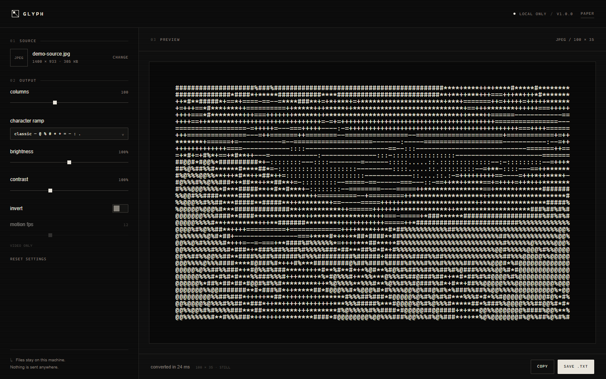
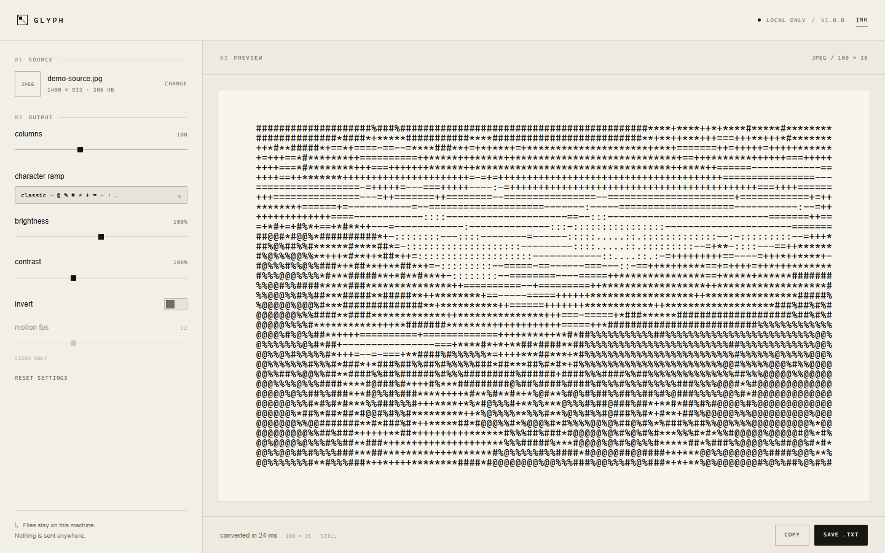

# Glyph

Glyph turns images, GIFs, and video clips into ASCII art locally. Drop a file into the browser UI (or paste an image), choose a character ramp, then copy the result or save it. By default, the Flask server listens only on `127.0.0.1`, so your files are not sent to a third party.

**English** · [Русский](README.ru.md)



## What it does

- **Still images:** PNG, JPEG, GIF, WebP, BMP, TIFF.
- **Animation:** GIF and animated WebP.
- **Video:** MP4, M4V, MOV, WebM, MKV, AVI, WMV, FLV, MPG, MPEG.
- Preview controls for output width, character ramp, inversion, brightness, and contrast.
- A separate, lower FPS setting for video previews to keep playback responsive.
- Copy the current frame to the clipboard.
- Save still images as `.txt`, or export animations as a standalone `.html` file with the frames embedded.
- Two monochrome themes: dark `ink` and light `paper`.

GIF timing is preserved. Video is decoded by the FFmpeg binary bundled with `imageio-ffmpeg`, so there is no need to install FFmpeg separately. Transparent pixels are flattened to black before conversion.

## Run it locally

Python 3.10 or newer is required.

```bash
git clone https://github.com/iamnopperabo/Glyph.git
cd Glyph

python -m venv .venv
```

Activate the virtual environment:

```powershell
# Windows PowerShell
.\.venv\Scripts\Activate.ps1
```

```cmd
:: Windows Command Prompt
.\.venv\Scripts\activate.bat
```

```bash
# macOS / Linux
source .venv/bin/activate
```

Install dependencies and start the app:

```bash
python -m pip install -r requirements.txt
python app.py
```

The app is available at [http://127.0.0.1:5000](http://127.0.0.1:5000). If the browser does not open automatically, use the URL printed in the terminal.

Optional flags:

```bash
python app.py --port 7000
python app.py --no-browser
```

On Windows, if `python` opens the Microsoft Store instead of running Python, install Python from [python.org](https://www.python.org/downloads/) or use the full path to your Python interpreter.

## Limits

- Maximum upload size: 100 MB.
- Animations are limited to 20 seconds and 240 frames. The UI marks a result as `trimmed` when this limit is reached.
- Output width is capped at 200 columns in the UI and 240 columns on the server.
- Conversion runs when requested, not in a background worker. Longer clips may take a little time to process.
- Uploads are temporary. They are stored in the system temp directory and deleted when the app exits or after one hour.

## Example

The screenshots use [this photo](docs/demo-source.jpg). A plain-text render is available in [docs/demo-ascii.txt](docs/demo-ascii.txt).

**Light theme**



## Tests

```bash
python -m pip install -r requirements-dev.txt
pytest
```

The video test generates a one-second clip using the bundled FFmpeg binary, so the test suite does not need a media file stored in the repository.

## How it works

Each frame is converted to grayscale, resized to the requested number of columns, and mapped to characters according to luminance. Rows are scaled by `0.52` to compensate for the tall proportions of a monospace character cell.

The conversion logic lives in `converter.py`; Flask handles uploads, options, and JSON responses.

## Credits

Built with [Flask](https://flask.palletsprojects.com/), [Pillow](https://python-pillow.org/), [imageio](https://imageio.readthedocs.io/), and [imageio-ffmpeg](https://github.com/imageio/imageio-ffmpeg).

Demo photo: [Unsplash](https://images.unsplash.com/photo-1464822759023-fed622ff2c3b) (Unsplash License).

## License

MIT. See [LICENSE](LICENSE).
