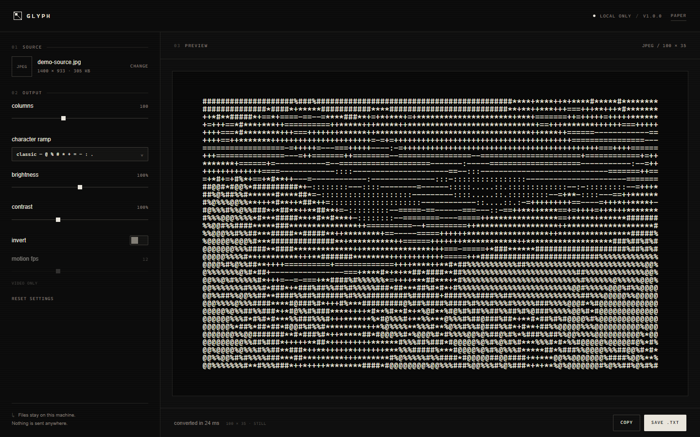
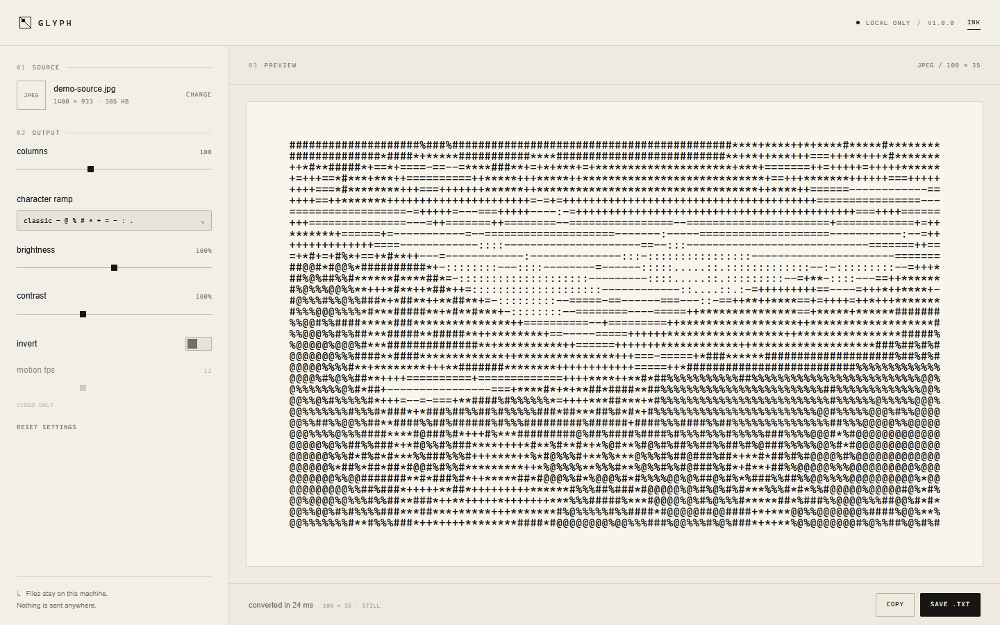

# Glyph

Glyph превращает изображения, GIF и видео в ASCII-графику локально. Загрузите файл в браузере (или вставьте изображение из буфера обмена), выберите набор символов, а затем скопируйте результат или сохраните его. По умолчанию Flask-сервер слушает только `127.0.0.1`, поэтому файлы не отправляются третьим лицам.

[English](README.md) · **Русский**



## Возможности

- **Статичные изображения:** PNG, JPEG, GIF, WebP, BMP, TIFF.
- **Анимация:** GIF и анимированный WebP.
- **Видео:** MP4, M4V, MOV, WebM, MKV, AVI, WMV, FLV, MPG, MPEG.
- Настройки ширины результата, набора символов, инверсии, яркости и контраста.
- Отдельная, более низкая частота кадров для предпросмотра видео — так интерфейс остаётся отзывчивым.
- Копирование текущего кадра в буфер обмена.
- Сохранение статичных изображений в `.txt`, а анимации — в автономный `.html` со встроенными кадрами.
- Две монохромные темы: тёмная `ink` и светлая `paper`.

Тайминг GIF сохраняется. Видео декодируется с помощью FFmpeg, который входит в комплект `imageio-ffmpeg`; отдельно устанавливать FFmpeg не нужно. Прозрачные пиксели перед конвертацией заливаются чёрным.

## Локальный запуск

Нужен Python версии 3.10 или новее.

```bash
git clone https://github.com/iamnopperabo/Glyph.git
cd Glyph

python -m venv .venv
```

Активируйте виртуальное окружение:

```powershell
# Windows PowerShell
.\.venv\Scripts\Activate.ps1
```

```cmd
:: Windows Command Prompt
.\.venv\Scripts\activate.bat
```

```bash
# macOS / Linux
source .venv/bin/activate
```

Установите зависимости и запустите приложение:

```bash
python -m pip install -r requirements.txt
python app.py
```

Приложение будет доступно по адресу [http://127.0.0.1:5000](http://127.0.0.1:5000). Если браузер не открылся автоматически, перейдите по адресу, который появится в терминале.

Дополнительные параметры:

```bash
python app.py --port 7000
python app.py --no-browser
```

На Windows команда `python` иногда открывает Microsoft Store вместо интерпретатора. В таком случае установите Python с [python.org](https://www.python.org/downloads/) или укажите полный путь к интерпретатору.

## Ограничения

- Максимальный размер файла: 100 МБ.
- Анимация ограничена 20 секундами и 240 кадрами. При достижении лимита интерфейс показывает пометку `trimmed`.
- Ширина результата ограничена 200 колонками в интерфейсе и 240 колонками на сервере.
- Конвертация запускается по запросу, без фоновой очереди. Обработка длинного видео может занять некоторое время.
- Загруженные файлы временные: они хранятся в системной временной папке и удаляются при выходе из приложения или через час.

## Пример

Для скриншотов использовано [это фото](docs/demo-source.jpg). Готовый текстовый результат находится в [docs/demo-ascii.txt](docs/demo-ascii.txt).

**Светлая тема**



## Тесты

```bash
python -m pip install -r requirements-dev.txt
pytest
```

Тест видео самостоятельно генерирует секундный клип с помощью встроенного FFmpeg, поэтому отдельный тестовый медиафайл в репозитории не нужен.

## Как это работает

Каждый кадр переводится в оттенки серого, масштабируется до нужного количества колонок и преобразуется в символы в зависимости от яркости пикселей. Высота строк умножается на `0.52`, чтобы компенсировать вытянутые пропорции моноширинного символа.

Логика конвертации находится в `converter.py`; Flask отвечает за загрузку файлов, настройки и JSON-ответы.

## Благодарности

Проект использует [Flask](https://flask.palletsprojects.com/), [Pillow](https://python-pillow.org/), [imageio](https://imageio.readthedocs.io/) и [imageio-ffmpeg](https://github.com/imageio/imageio-ffmpeg).

Демо-фото: [Unsplash](https://images.unsplash.com/photo-1464822759023-fed622ff2c3b) (Unsplash License).

## Лицензия

MIT. Подробности — в файле [LICENSE](LICENSE).
